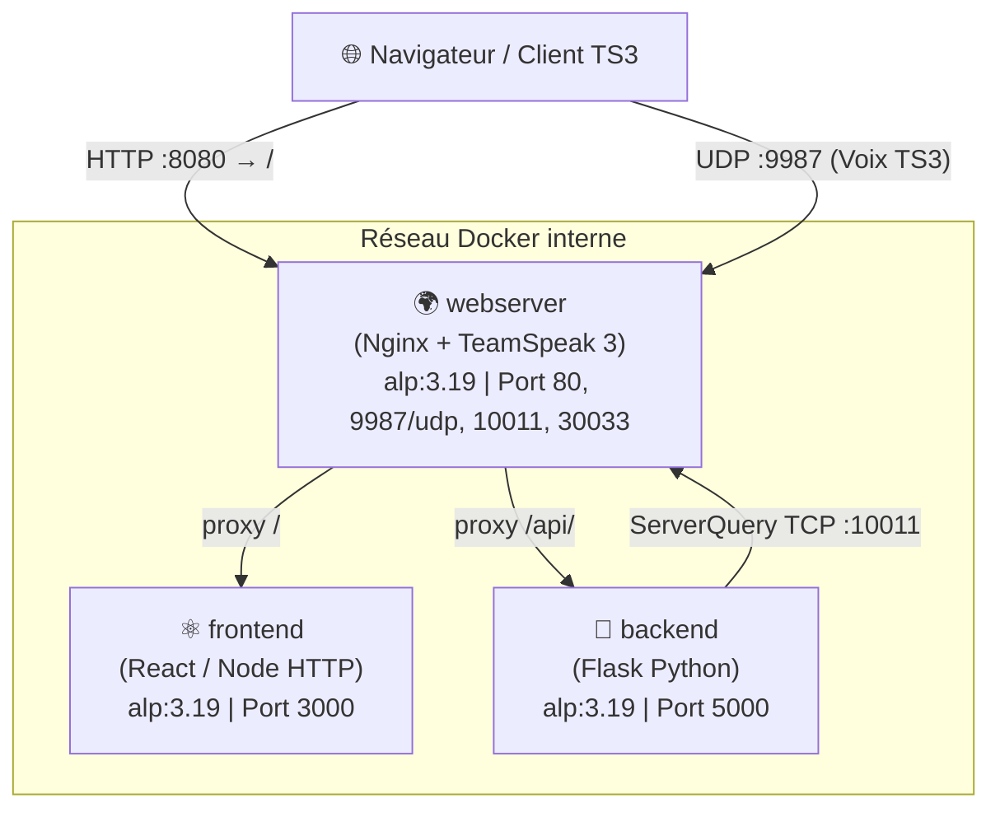

# TP 1 — Docker Cloud : Tableau de Bord TeamSpeak

Projet d'infrastructure virtualisée sous Docker simulant un cloud privé hébergeant un **serveur de jeux TeamSpeak 3**, son dashboard de contrôle (frontend React) et son API de gestion (backend Python/Flask).

Toutes les images sont construites sur une base minimale `alpine:3.19` — **aucune image applicative pré-faite du Docker Hub** n'est utilisée.

---

## Architecture globale



**Flux réseau :**
- `http://localhost:8080/` : Nginx achemine le trafic web vers le **frontend** React ou vers le **backend** Flask (`/api/`).
- `localhost:9987/udp` : flux vocal direct vers le serveur TeamSpeak.
- `webserver:10011/tcp` : interface d'administration ServerQuery interrogée par le backend Python.

---

## 1. Choix au Build (Images Docker)

### 1.1 Image de base : `alpine:3.19`
Alpine Linux (~5 Mo) a été choisie pour l'ensemble des images :
- Empreinte disque et mémoire minimale.
- Surface d'attaque réduite (absence de daemons ou binaires superflus).
- Respect strict de la contrainte "0 image pré-faite".

### 1.2 Frontend React (`frontend/Dockerfile`)
| Paramètre | Choix | Justification |
|---|---|---|
| **Base** | `alpine:3.19` | Image minimale |
| **Packages OS** | `nodejs`, `npm` | Runtime d'exécution et gestionnaire de paquets |
| **Build** | `npm run build` | Compilation Vite des assets statiques dans `dist/` |
| **Serveur HTTP** | `node server.js` | Serveur HTTP natif Node.js servant `dist/` sans dépendance tierce |
| **Port** | `3000` | Port d'écoute interne |
| **Arrêt propre** | `SIGTERM` | Handler `process.on('SIGTERM')` fermant le serveur HTTP avant sortie |

### 1.3 Backend Python (`backend/Dockerfile`)
| Paramètre | Choix | Justification |
|---|---|---|
| **Base** | `alpine:3.19` | Image minimale |
| **Packages OS** | `python3`, `py3-pip` | Interpréteur Python et outil d'installation |
| **Dépendances** | `flask==3.0.3`, `ts3==1.0.11` | API REST et connecteur ServerQuery TeamSpeak |
| **Flag pip** | `--break-system-packages` | Requis sous Alpine 3.19 pour installer sans virtualenv |
| **Port** | `5000` | Port d'écoute Flask |
| **Arrêt propre** | `SIGTERM` | Capture du signal via le module `signal` (`stop_server`) |

### 1.4 Webserver & TeamSpeak (`webserver/Dockerfile`)
Ce container cumule le rôle de **reverse proxy HTTP** (Nginx) et de **serveur vocal** (TeamSpeak 3).

| Dépendance / Action | Rôle |
|---|---|
| `nginx` | Point d'entrée unique et routage HTTP |
| `bzip2`, `wget` | Téléchargement et extraction de l'archive officielle `.tar.bz2` |
| `libc6-compat`, `libstdc++`, `libgcc` | Shims de compatibilité glibc indispensables sur Alpine (musl) pour faire tourner le binaire compilé de TS3 |
| `adduser -D teamspeak` | Principe de moindre privilège : le binaire TS3 ne tourne pas sous root |
| `mkdir -p /run/nginx` | Prérequis de démarrage pour que Nginx écrive son fichier PID |
| `EXPOSE` | `80` (HTTP), `9987/udp` (voix), `10011` (ServerQuery), `30033` (transfert fichiers) |

**Entrypoint (`start.sh`) :**
Un script shell externe est utilisé comme PID 1 pour orchestrer les deux processus :
1. Démarre TeamSpeak en tâche de fond avec l'utilisateur système `teamspeak`.
2. Démarre Nginx avec `daemon off;` pour empêcher le fork en arrière-plan.
3. Capture les signaux `TERM` et `INT` via `trap` pour les relayer aux PIDs enfants avant extinction.

---

## 2. Configuration à l'Exécution (Docker Compose)

### 2.1 Variables d'environnement
- `backend` : `PORT=5000`, `TS3_HOST=webserver`, `TS3_PORT=10011`
- `frontend` : `PORT=3000`
- `webserver` : `TS3_ADMIN_PASSWORD=adminpass123`

### 2.2 Limitation des ressources
Chaque container dispose de limites strictes pour éviter la monopolisation de l'hôte :

| Service | CPU max | RAM max | Justification |
|---|:---:|:---:|---|
| `backend` | `0.50` | `256M` | Application I/O-bound légère avec driver TCP ServerQuery |
| `frontend` | `0.50` | `256M` | Service de fichiers statiques en mémoire tampon |
| `webserver` | `0.25` | `128M` | Nginx consomme < 10 Mo ; TS3 à vide consomme ~40 Mo |

### 2.3 Ordonnancement du démarrage
Le `webserver` attend que le backend et le frontend soient validés par leurs sondes de santé :
```yaml
depends_on:
  backend:
    condition: service_healthy
  frontend:
    condition: service_healthy
```
Les `healthcheck` utilisent `wget --spider` pour tester les endpoints HTTP locaux toutes les 5 secondes.

---

## 3. Consigne Supplémentaire : CI/CD & Scaling

### 3.1 Container de Lint (`lint/Dockerfile`)
Analyse statique multi-langage exécutée dans un container éphémère avec montage des sources en lecture seule (`:ro`) :
- **Python** : `flake8` (conformité PEP8) + `pylint` (score minimal exigé).
- **Frontend** : `eslint` (règles JavaScript/React).

Lancement :
```bash
docker compose --profile ci run --rm lint
```

### 3.2 Container de Tests d'Intégration (`tests/Dockerfile`)
Suite de tests automatisés basée sur `pytest` et `requests`, validant les endpoints Flask et les retours ServerQuery :
- Test de disponibilité (`/api/health`).
- Intégrité des données de session (`/api/stats`, `/api/channels`, `/api/users`).

Lancement :
```bash
docker compose --profile ci run --rm tests
```

### 3.3 Auto-Scaling & Stress Tests
- **Surcharge Compose** ([`docker-compose.scale.yml`](docker-compose.scale.yml)) : passage du service webserver à 2 réplicas avec élévation des quotas à `0.65 CPU` et `256M RAM`.
- **Script de montée en charge** ([`scripts/stress_test.ps1`](scripts/stress_test.ps1)) : simulation de requêtes ServerQuery simultanées et flux UDP voice sur le port 9987.
- **Rapport généré** : consultable dans [`scripts/stress_report.md`](scripts/stress_report.md).

---

## 4. Démarrage et Validation

```bash
# 1. Démarrer l'infrastructure
docker compose up --build -d

# 2. Vérifier l'état et l'accès
# Frontend  : http://localhost:8080
# API Flask : http://localhost:8080/api/stats
# Client TS : localhost:9987 (UDP)

# 3. Lancer la suite CI/CD
docker compose --profile ci run --rm lint
docker compose --profile ci run --rm tests

# 4. Arrêt propre (test SIGTERM)
docker compose down
```

---

## 5. Docker vs Solutions de Virtualisation Historiques

| Critère | Machine Virtuelle Classique (VM) | Container Docker |
|---|---|---|
| **Architecture** | Hyperviseur (Type 1 ou 2) émulant du matériel complet | Partage direct du noyau Linux de l'hôte via `cgroups` et `namespaces` |
| **Système Invité** | OS invité complet avec son propre kernel (plusieurs Go) | Aucune duplication d'OS : simple userland (ex: Alpine ~5 Mo) |
| **Consommation** | Réservation statique de RAM/CPU avec fort overhead | Allocation dynamique et limites fines par container |
| **Démarrage** | Plusieurs dizaines de secondes à quelques minutes | Quelques fractions de seconde (démarrage d'un processus isolé) |
| **Densité** | Limitée par le nombre d'OS complets concurrents | Élevée : plusieurs dizaines/centaines de containers par machine |
